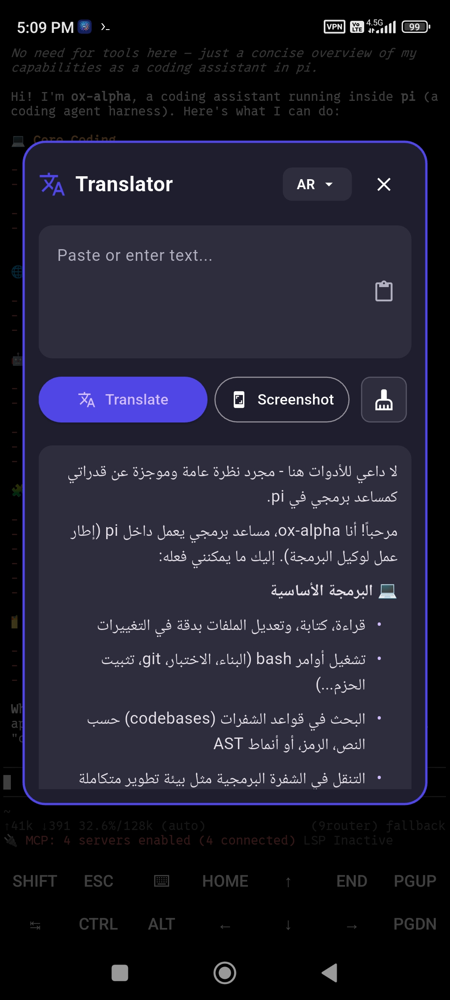
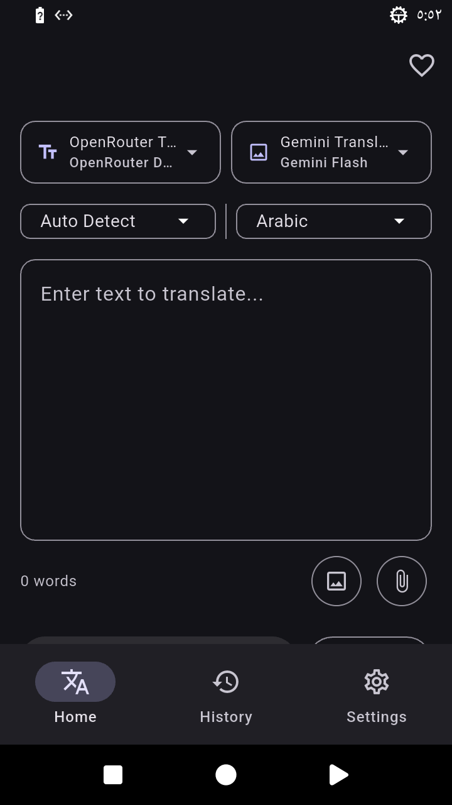
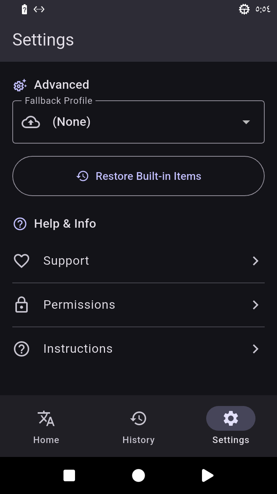
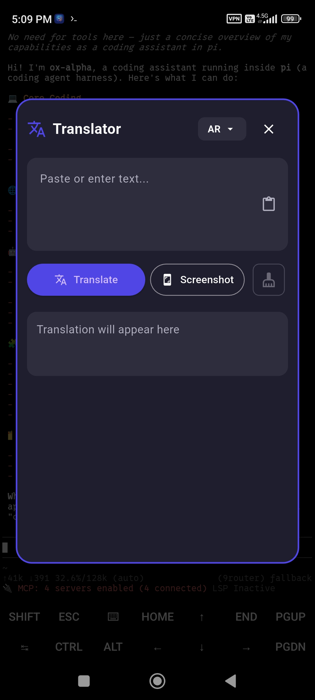
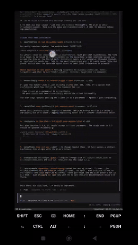

<div dir="rtl">

# جسور

**عبر فجوة اللغات — ترجمة بالذكاء الاصطناعي تطفو فوق أي تطبيق.**

**اقرأ هذا باللغة:** العربية · [English](README.md)

[](LICENSE)
[](https://www.android.com/)
[](https://dart.dev/)
[](CONTRIBUTING.md)

جسور تطبيق أندرويد مجاني ومفتوح المصدر يضع قوة الترجمة بالذكاء الاصطناعي في
نافذة عائمة فوق أي تطبيق آخر: انسخ أو التقط شاشة أو شارك نصاً أو صورة، واحصل
على ترجمتها فوراً عبر مزوّد الذكاء الاصطناعي الذي تختاره بنفسك.

<p align="center">
  
</p>
<p align="center"><em>نافذة جسور العائمة فوق Termux — تترجم النص المعروض في مكانه.</em></p>

| الرئيسية | الإعدادات |
|---|---|
|  |  |
| **النافذة (فارغة)** | **النافذة (مترجمة)** |
|  |  |

## زر الإعدادات السريعة أثناء العمل

شاهد كيف يشغّل **زر الإعدادات السريعة** النافذة العائمة، ويفتحها فوق أي تطبيق،
ويترجم النص في مكانه — دون نسخ ودون التنقل بين التطبيقات:

<p align="center">
  
</p>
<p align="center"><em>النافذة تُستدعى من لوحة الإعدادات السريعة — ترجم أي شيء، في أي مكان.</em></p>

## ما هو جسور؟

صُمّم جسور لتلك اللحظات التي تصطدم فيها بلغة لا تفهمها وأنت داخل تطبيق آخر:
بدل الخروج من التطبيق، تستدعي نافذة جسور العائمة فوق ما تعمل عليه وتحصل على
الترجمة في الحال. الواجهة عربية أولاً باتجاه كامل من اليمين إلى اليسار مع دعم
إنجليزي كامل، وتبقى أنت المتحكّم: تُدخل مفاتيح API الخاصة بك، وتُحفظ على جهازك
فقط.

- **ترجمة فوق كل شيء** — نافذة عائمة تعمل فوق التطبيقات الأخرى، مع زر
  تشغيل/إيقاف في لوحة الإعدادات السريعة.
- **إدخال نصي وصوري** — اكتب أو الصق نصاً، أو اختر صورة، أو شارك المحتوى
  مباشرةً إلى جسور من أي تطبيق.
- **٢٩ لغة + الكشف التلقائي** — اختر لغة الهدف، وتُكتشف لغة المصدر تلقائياً،
  والعربية والإنجليزية والتركية في أول القائمة.
- **قوالب مطالبات (Templates)** — قوالب قابلة لإعادة الاستخدام مع استبدال
  المتغير `{{target_language}}` تلقائياً، أو إرساله حرفياً عبر خيار لكل قالب.
- **اختر مزوّدك بنفسك** — Google Gemini أو OpenRouter أو أي نقطة نهاية متوافقة
  مع OpenAI‏ (Ollama و LM Studio و vLLM وغيرها).
- **نتائج مريحة للقراءة** — محرر وعارض بملء الشاشة للنص الطويل والترجمات
  الطويلة، مع إعداد حجم النص بالبكسل (حجم النظام افتراضياً، وحجم منفصل للترجمة
  وحدها إن أردت).
- **سجل الترجمات** — كل نتيجة تُحفظ، وقابلة للبحث والمشاركة.
- **واجهة عربية أولاً** — تخطيط كامل بالاتجاه من اليمين إلى اليسار، والإنجليزية
  خيار ثانٍ، مع تبديل فوري للغة من الإعدادات.
- **الخصوصية أولاً** — مفاتيح API تبقى على جهازك عبر تخزين آمن، والطلبات تنطلق
  مباشرةً من هاتفك إلى مزوّدك دون أي وسيط.

## لماذا هذه الأذونات؟

لا يطلب جسور إلا ما تحتاجه ميزاته فعلاً. هذه القائمة بشفافية كاملة:

| الإذن | لماذا يحتاجه جسور |
| --- | --- |
| `INTERNET` | للوصول إلى مزوّد الذكاء الاصطناعي الذي تُعدّه؛ يُمنح تلقائياً عند التثبيت. |
| `SYSTEM_ALERT_WINDOW` | لعرض النافذة العائمة فوق التطبيقات الأخرى — الميزة الأساسية؛ يُمنح عبر إعدادات النظام. |
| `FOREGROUND_SERVICE` | للحفاظ على عمل النافذة العائمة أثناء استخدامك للتطبيقات الأخرى. |
| `FOREGROUND_SERVICE_SPECIAL_USE` | تصريح نوع الخدمة الأمامية الخاص بالنافذة العائمة (متطلب من أندرويد). |
| `FOREGROUND_SERVICE_MEDIA_PROJECTION` | يشغّل «لقطة شاشة ← ترجمة»؛ كل التقاط يتطلب موافقة صريحة من النظام. |
| `POST_NOTIFICATIONS` | إشعار خدمة النافذة العائمة (أندرويد 13 وما بعده). |
| `WAKE_LOCK` | يُدمَج تلقائياً من إضافة النافذة العائمة؛ يحافظ على استجابة النافذة. |

تعرض صفحة **الأذونات** داخل التطبيق حالة كل إذن لحظياً، مع اختصار بلمسة واحدة
للمنح أو السحب.

## التنزيل والتثبيت

حمّل الحزمة من صفحة [الإصدارات](https://github.com/digitaltrekkerr/jusoor/releases):
نسخة `arm64-v8a` للهواتف والأجهزة اللوحية، و`x86_64` للمحاكيات، وتحتوي كل صفحة
إصدار أيضاً على `armeabi-v7a` للأجهزة القديمة 32-بت. لا تحتوي الحزمة على أي
بيانات اعتماد: تُدخل مفتاح مزوّدك بنفسك من الإعدادات ويبقى على جهازك.

**البناء من المصدر:**

المتطلبات:

- Flutter SDK ‏(القناة المستقرة؛ يستهدف المشروع ‏Dart SDK ‏`^3.10.8`)
- Android SDK — يُصرَّف وفق API 36 ويعمل على أندرويد 8.0 فما فوق (API 26)
- [Melos](https://pub.dev/packages/melos) ‏(`dart pub global activate melos`)

```bash
git clone https://github.com/digitaltrekkerr/jusoor.git
cd jusoor
melos bootstrap        # يربط حزم مساحة العمل عبر pubspec overrides
cd translation_app
flutter run            # مع جهاز أو محاكٍ متصل
```

لبناء نسخة الإصدار: `flutter build apk --release` (إعدادات التوقيع موجودة في
`translation_app/android/app/build.gradle`).

## البنية المعمارية

مساحة عمل Melos — تطبيق واحد وأربع حزم متخصصة:

| المسار | الدور |
| --- | --- |
| `translation_app/` | تطبيق Flutter نفسه: الشاشات، الترجمة المحلية (AR/EN)، حالة Riverpod، وتكامل النافذة العائمة. |
| `packages/translation_core/` | عملاء المزوّدين (Gemini و OpenRouter والمتوافق مع OpenAI) والنماذج والقوالب. |
| `packages/file_handler/` | قراءة الملفات وكشف نوع MIME للملفات المشتركة أو المستوردة. |
| `packages/history/` | حفظ سجل الترجمات والاستعلام عنه. |
| `packages/markdown_renderer/` | عرض نتائج Markdown بوعي الاتجاه الثنائي (BiDi). |

## المساهمة

نرحب بمساهماتكم! يُرجى قراءة [CONTRIBUTING.md](CONTRIBUTING.md) أولاً، وتشغيل
`melos analyze` و `melos test` قبل فتح طلب الدمج.

## الأمان

هل عثرت على ثغرة؟ من فضلك **لا تفتح** مشكلة عامة — اتبع خطوات الإبلاغ الموضحة
في [SECURITY.md](SECURITY.md).

## الرخصة

يُنشر المشروع بموجب رخصة [MIT](LICENSE).

## الدعم 💜

إذا وفّر لك جسور وقتاً، ففكر في دعم التطوير عبر
[باتريون](https://www.patreon.com/cw/DigitalTrekkerr/membership)، وضع نجمة ⭐
على المستودع إن وجدته مفيداً.

</div>
