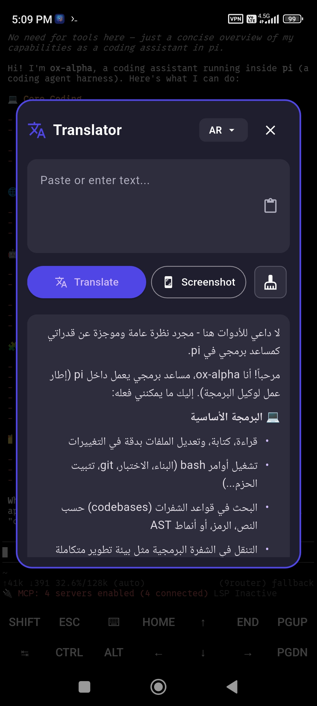
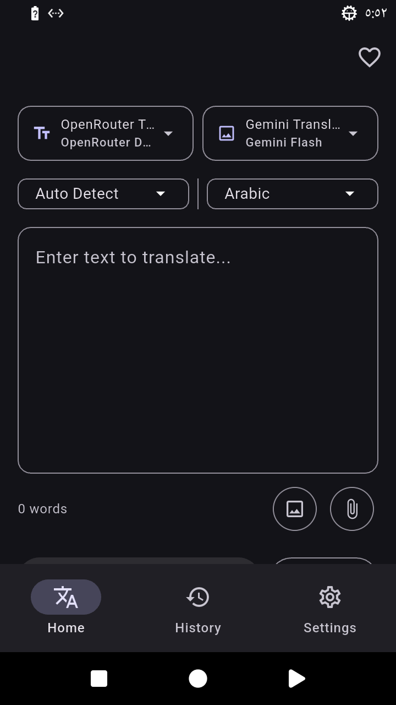
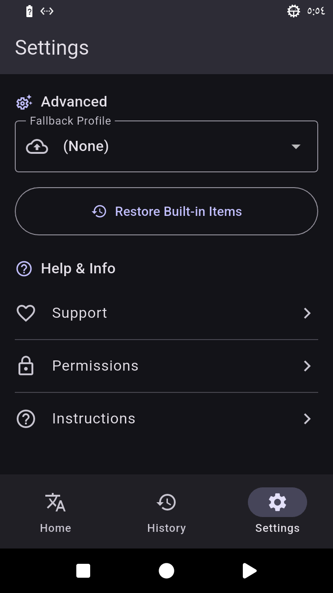
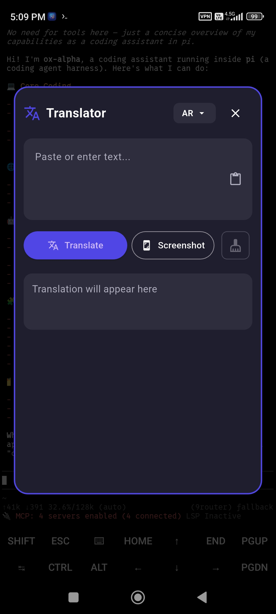
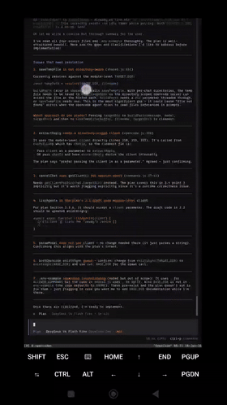

# Jusoor

**Bridge the language gap — AI translation that floats above any app.**

**Read this in:** English · [Arabic](README.ar.md)

[](LICENSE)
[](https://www.android.com/)
[](https://dart.dev/)
[](CONTRIBUTING.md)

Jusoor (Arabic for *bridges*) is a free, open-source Android app that puts AI
translation in a floating overlay above any other app — select, screenshot,
share, or paste text and images and translate them through the LLM provider of
your choice.

<p align="center">
  
</p>
<p align="center"><em>Jusoor's overlay floating above Termux — translating the on-screen text in place.</em></p>

| Home | Settings |
|---|---|
|  |  |
| **Overlay (empty)** | **Overlay (translated)** |
|  |  |

## Quick tile in action

Watch how the **Quick Settings tile** launches the floating overlay, opens it
on top of any app, and translates text in place — no copying, no switching
apps:

<p align="center">
  
</p>
<p align="center"><em>The overlay summoned from the Quick Settings tile — translate anything, anywhere.</em></p>

## What is Jusoor?

Jusoor is built for moments when you are inside another app and hit a language
you do not read: instead of switching apps, you summon Jusoor's overlay on top
of whatever you are doing and get an instant translation. It is Arabic-first
(full RTL interface) with full English support, and you stay in control — you
bring your own API keys, stored only on your device.

- **Translate over anything** — a floating overlay works above other apps;
  start and stop it from a Quick Settings tile.
- **Text & image input** — type or paste text, pick an image, or share content
  straight into Jusoor from any app.
- **29 languages + Auto Detect** — pick your target language; the source is
  detected automatically. Arabic, English, and Turkish sit at the top of the
  list.
- **Prompt templates** — reusable templates with `{{target_language}}`
  substitution (or send it literally with the per-template toggle).
- **Bring your own provider** — Google Gemini, OpenRouter, or any
  OpenAI-compatible endpoint (Ollama, LM Studio, vLLM, …).
- **Readable results** — full-screen editor and viewer for long input and long
  translations, plus a text-size setting in px (system size by default, with a
  separate size for translation output only).
- **Translation history** — every result is saved, searchable, and shareable.
- **Arabic-first UI** — complete RTL layout, English secondary, instant locale
  switch from Settings.
- **Private by design** — API keys live on-device via secure storage; requests
  go directly from your phone to your provider. No middleman server.

## Why these permissions?

Jusoor asks only for what its features need. Honest inventory:

| Permission | Why Jusoor needs it |
| --- | --- |
| `INTERNET` | Reaches your configured AI provider. Granted at install time. |
| `SYSTEM_ALERT_WINDOW` | Draws the overlay above other apps — the core feature; special system grant. |
| `FOREGROUND_SERVICE` | Keeps the overlay alive while you use other apps. |
| `FOREGROUND_SERVICE_SPECIAL_USE` | Declares the overlay's foreground-service type (Android requirement). |
| `FOREGROUND_SERVICE_MEDIA_PROJECTION` | Powers screenshot translate; each capture needs explicit system consent. |
| `POST_NOTIFICATIONS` | Overlay service notification (Android 13+). |
| `WAKE_LOCK` | Merged in by the overlay plugin; keeps the overlay responsive. |

The in-app **Permissions** page shows the live grant status of each permission
with one-tap shortcuts to grant or revoke.

## Download & Install

Grab the APK from the [Releases](https://github.com/digitaltrekkerr/jusoor/releases)
page — `arm64-v8a` for phones and tablets, `x86_64` for emulators. Every release
also carries `armeabi-v7a` for older 32-bit devices. The APK ships with no
credentials: you enter your own provider API key in Settings, and it stays on
your device.

**Build from source:**

Prerequisites:

- Flutter SDK (stable channel; the project targets Dart SDK `^3.10.8`)
- Android SDK — compiles against API 36, runs on Android 8.0+ (API 26)
- [Melos](https://pub.dev/packages/melos) (`dart pub global activate melos`)

```bash
git clone https://github.com/digitaltrekkerr/jusoor.git
cd jusoor
melos bootstrap        # links workspace packages via pubspec overrides
cd translation_app
flutter run            # with a device or emulator connected
```

For a release build: `flutter build apk --release` (signing config lives in
`translation_app/android/app/build.gradle`).

## Architecture

Melos monorepo — one app plus four focused packages:

| Path | Role |
| --- | --- |
| `translation_app/` | The Flutter app: screens, l10n (AR/EN), Riverpod state, Android overlay integration. |
| `packages/translation_core/` | Provider clients (Gemini, OpenRouter, OpenAI-compatible), models, templates. |
| `packages/file_handler/` | File reading and MIME detection for shared/imported files. |
| `packages/history/` | Translation history persistence and queries. |
| `packages/markdown_renderer/` | BiDi-aware Markdown rendering of translation results. |

## Contributing

Contributions are welcome! Please read [CONTRIBUTING.md](CONTRIBUTING.md)
first. Run `melos analyze` and `melos test` before opening a pull request.

## Security

Found a vulnerability? Please do **not** open a public issue — follow the
reporting process in [SECURITY.md](SECURITY.md).

## License

Released under the [MIT License](LICENSE).

## Support 💜

If Jusoor saves you time, consider supporting development on
[Patreon](https://www.patreon.com/cw/DigitalTrekkerr/membership), and give the
repo a ⭐ if you find it useful.
